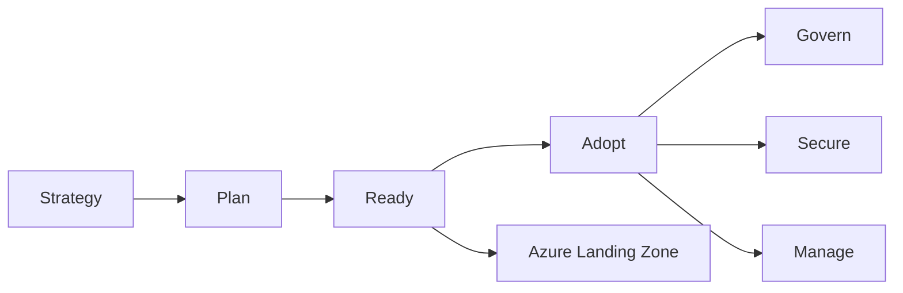
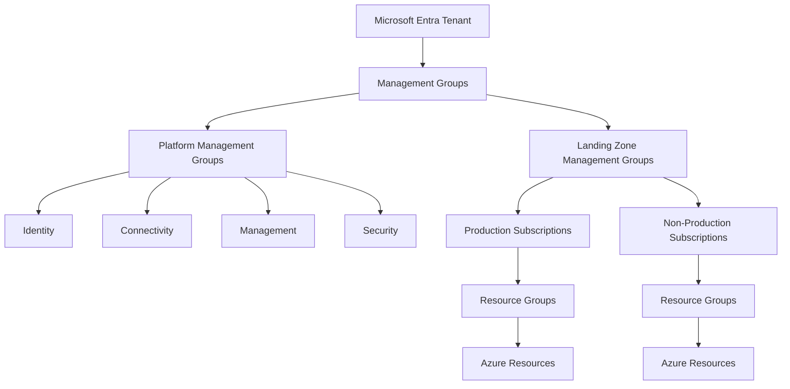
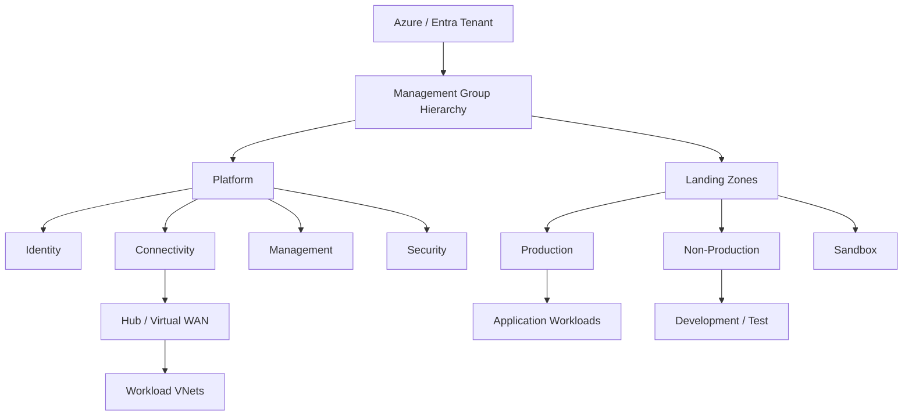
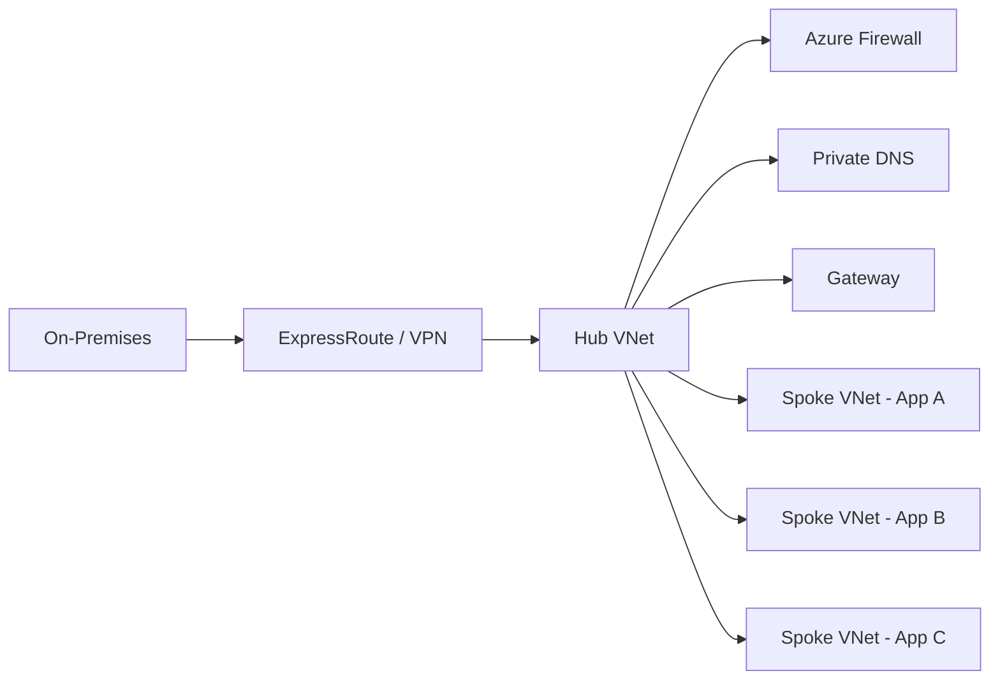
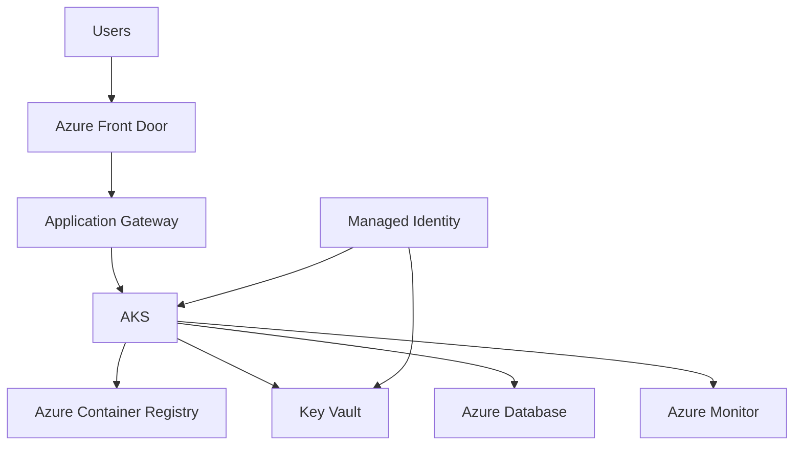
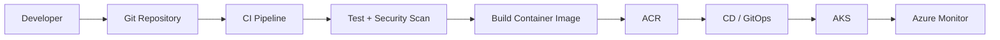
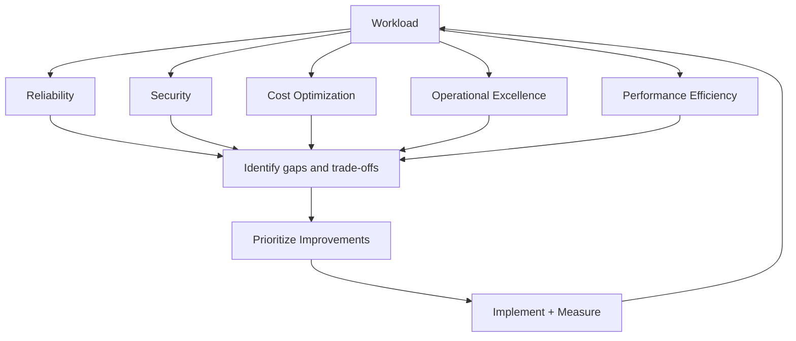
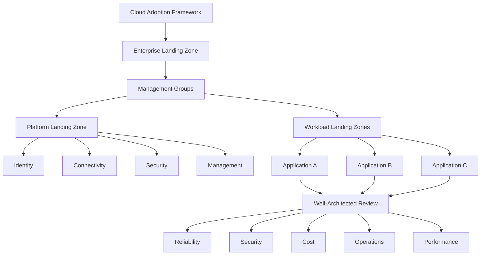

# 04 — Azure CAF / WAF / ELZ Architecture Diagrams

All diagrams use Mermaid and can be rendered directly in many GitHub Markdown contexts.

---

## Diagram 1 — CAF Adoption Journey

### 30-second explanation

CAF provides the adoption roadmap. Strategy defines the business outcomes, Plan prepares the organization, Ready establishes the landing zone, Adopt delivers workloads, and Govern/Secure/Manage establish ongoing controls and operations.

---

## Diagram 2 — Azure Hierarchy

---

## Diagram 3 — Enterprise Landing Zone

---

## Diagram 4 — Hub-Spoke Connectivity

---

## Diagram 5 — Production Application

---

## Diagram 6 — CI/CD to AKS

---

## Diagram 7 — WAF Review

---

## Diagram 8 — Complete Enterprise View

